

# Tom Harwood / ncypher

### Forward-deployed AI engineer. I sit with the people doing the work, break down what they actually need, and orchestrate teams of AI agents to ship it to production.

AI Solutions Architect at KW Corporation · Founder, CuREOsity Labs · REO Town, Lansing

[CuREOsity Labs](https://cureositylabs.com)

**[About me / Interactive resume](https://ncypher.github.io/tomfoolery/about.html) · [Explore the collection](https://ncypher.github.io/tomfoolery/) · [Enter the Journal Room](https://ncypher.github.io/tomfoolery/journal/) · [Read the philosophy](https://ncypher.github.io/tomfoolery/artifacts/philosophy.html)**

## How I work

**Field → Spec:** on site with operators/customers; translate what they say into what they need.

**Spec → Agents:** decompose into staged work orders; run parallel agent lanes; I hold the context.

**Agents → Evidence:** nothing ships on the agents’ word — tests, runtime, and users decide.

## Shipped

- **KWikSync** — ServiceNow Store-certified and deployed in a large enterprise, managing a growing estate of **90,000+ IT and commercial assets**, from infrastructure to edge devices.
- **Stitch**
- **Q2Q middleware**
- **R.E.P.O.** — Vision extraction + human review.

<!-- TOM: one 2-sentence story — "They asked for X. What they needed was Y." -->

## The work behind the experiments

I build where real operations meet software: field service, warehouses, accounting, documents, integrations, and the people moving between them.

### KWikSync · From the footprint to the field

<table>
<tr>
<td width="22%" align="center" valign="middle">
<a href="assets/showcase/kwiksync-logo.png">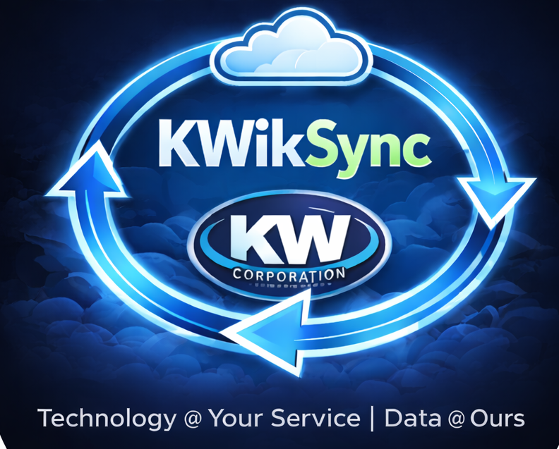</a>
</td>
<td valign="middle">

<b>See the operation. Follow the work. Inspect the evidence.</b>

Connected views for locations, projects, assets, surveys, and synchronization in ServiceNow. Move from the company-wide picture to the details a field team needs—and the evidence a reviewer can inspect.

Portfolio screenshots use test data. Click any image for a closer look.

</td>
</tr>
</table>

<b>See the operation · company footprint and project progress</b>

<table>
<tr>
<td width="50%" valign="top">
<a href="assets/showcase/kwiksync-footprint.png">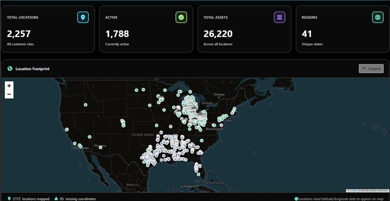</a>

<b>01 · See the footprint</b> Locations and assets in geographic context, with the operational totals alongside them.

</td>
<td width="50%" valign="top">
<a href="assets/showcase/kwiksync-projects.png">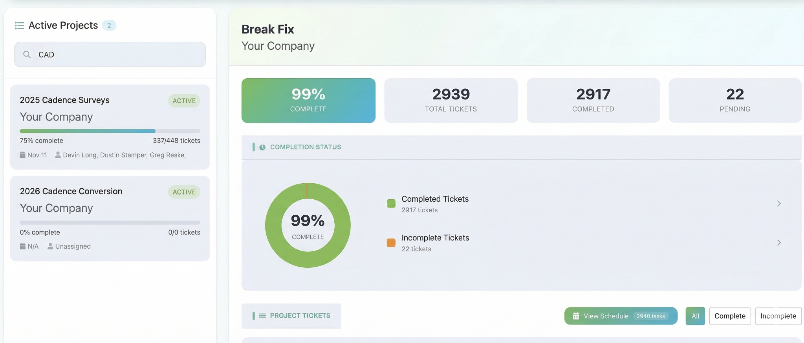</a>

<b>02 · Follow the work</b> Project progress, completed tickets, and pending work in one view.

</td>
</tr>
</table>

<b>Facilities management &amp; site surveys · proven across 2,000+ site surveys and visits</b>

Built to support facilities management through structured site assessments, equipment documentation, photos, and human review. Proven across **2,000+ site surveys and visits**, this implementation focuses on **IT asset management—from infrastructure to edge devices**. The survey approach can be adapted to other facility types and assessment needs.

#### Find the site

<a href="assets/showcase/kwiksync-locations.png">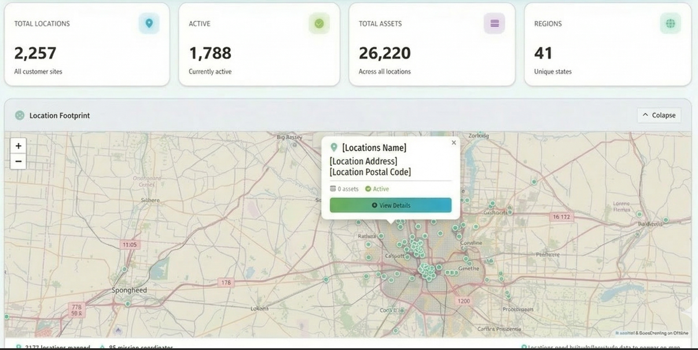</a>

The map connects the overall footprint to an individual location.

#### Review the fieldwork

<a href="assets/showcase/kwiksync-survey.png">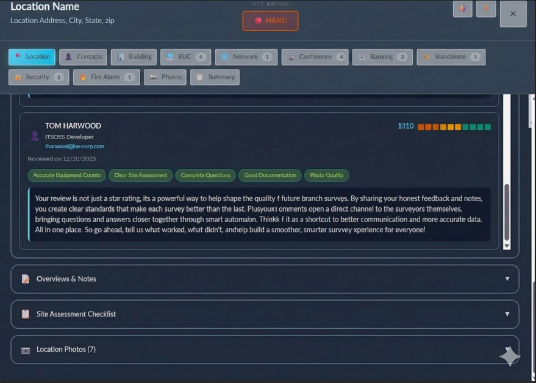</a>

Survey review brings assessment notes, documentation quality, and reviewer feedback together.

<b>The Curator · photo evidence and visual verification</b>

#### Inspect the evidence

<a href="assets/showcase/kwiksync-curator.png">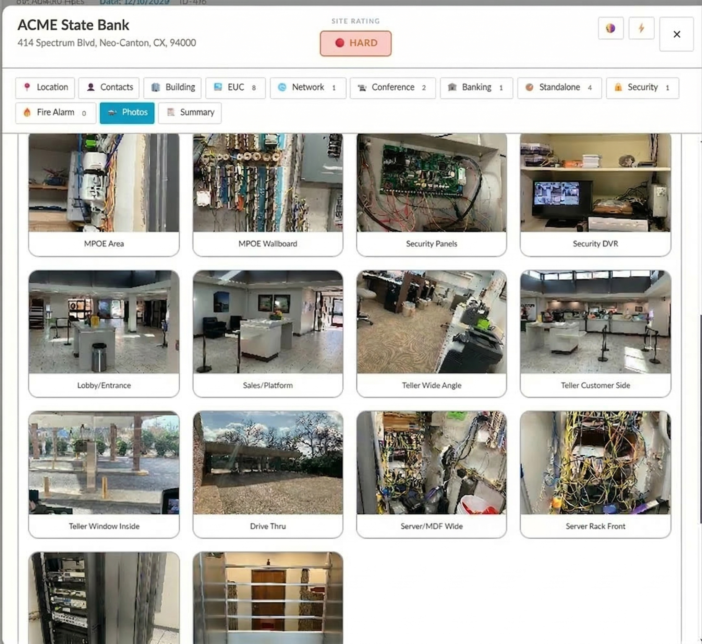</a>

Organized site photos give reviewers a visual record of equipment and conditions.

#### Look closer with the Curator

<a href="assets/showcase/kwiksync-verification.png">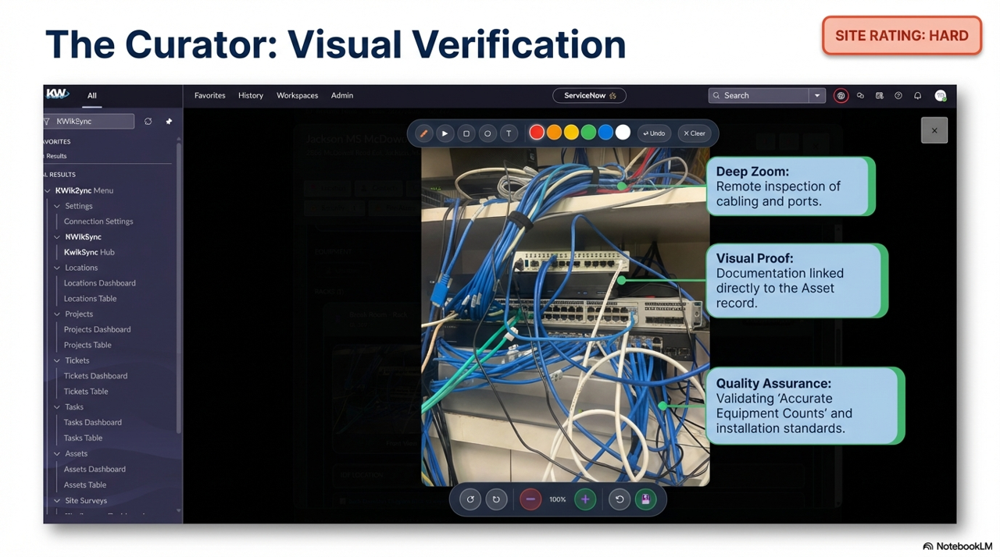</a>

A closer look at visual verification: zoom into equipment photos, annotate details, and relate the evidence to the asset record.

<b>Under the hood · data synchronization and activity log</b>

#### Bring the records together

<a href="assets/showcase/kwiksync-data-sync.png">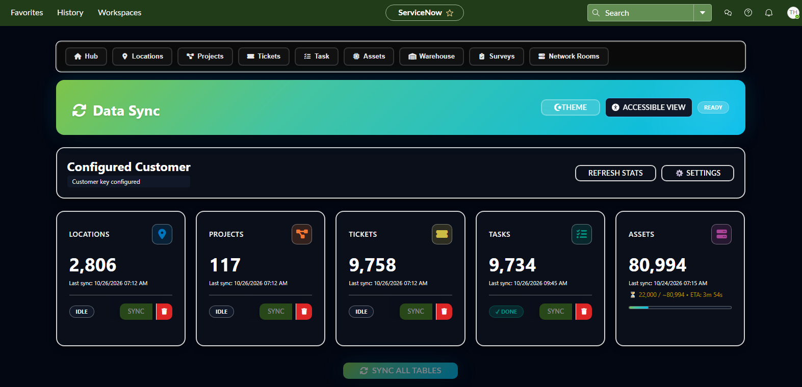</a>

A single dashboard for synchronizing operational records into ServiceNow, with per-table controls and progress indicators.

#### Follow the sync

<a href="assets/showcase/kwiksync-sync-activity.png">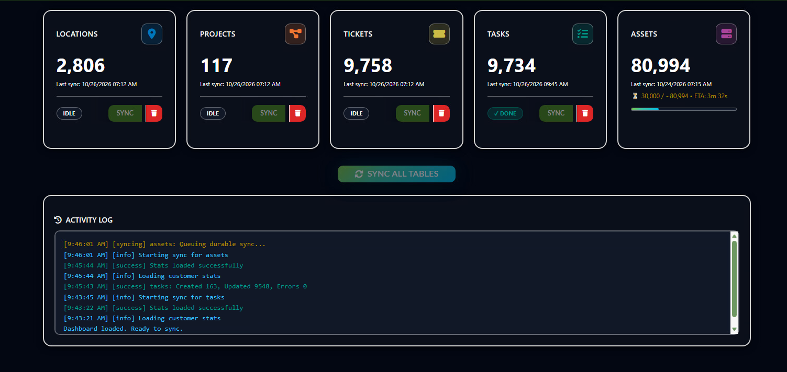</a>

The activity log makes sync progress and outcomes visible.

<table>
<tr>
<td width="50%" valign="top">
<a href="https://github.com/ncypher/stitch-public">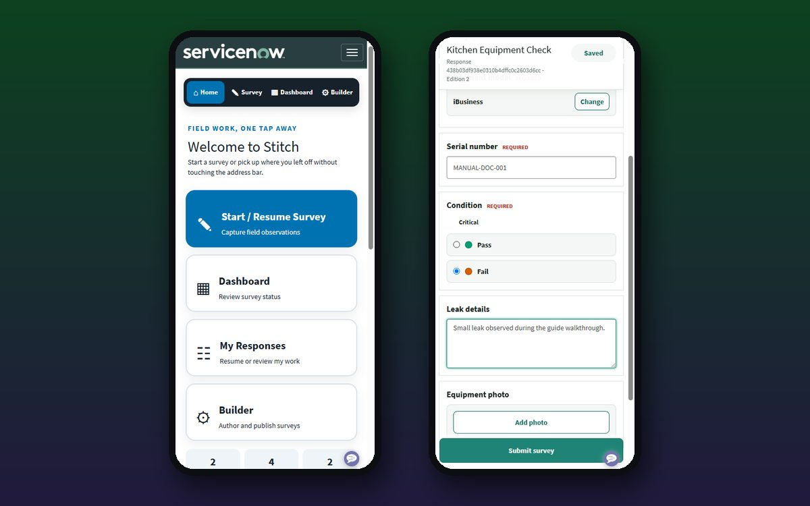</a>

<a href="https://github.com/ncypher/stitch-public"><b>Stitch</b></a> A ServiceNow app, built for the ServiceNow Store, for building field surveys, capturing evidence on a phone, and routing it for review. Shown with demo data.

</td>
<td width="50%" valign="top">
<a href="https://cureositylabs.com/#workbench">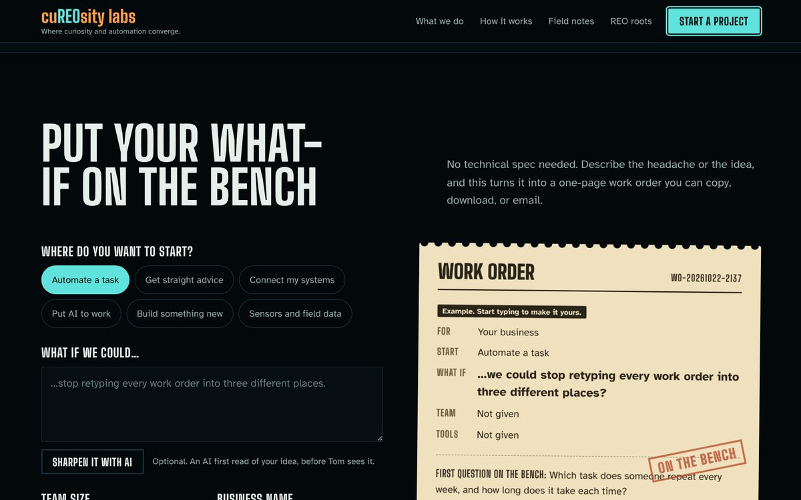</a>

<a href="https://cureositylabs.com/#workbench"><b>cuREOsity Labs</b></a> My REO Town technology workshop. Its site doubles as a working example: describe a headache and the workbench turns it into a work order.

</td>
</tr>
</table>

| System | What it connects |
| --- | --- |
| **KWikSync** | Field operations, locations, assets, tasks, evidence, and ServiceNow |
| **Q2Q** | Accounting, time tracking, service management, fleet, and operational data |
| **R.E.P.O.** | Receipts and invoices, AI extraction, validation, and human review |
| **Warehouse management** | Materials, vehicles, facilities, labor, billing, and inventory history |
| **Enterprise operations** | Dispatch, CRM, routing, workforce coordination, and reporting |

Python · JavaScript · ServiceNow · Quickbase · REST APIs · Docker

[**Meet the person behind the systems →**](https://ncypher.github.io/tomfoolery/about.html) Archaeology, fieldwork, operations, and AI-assisted software: explore the career connecting them.

## Start with something you can touch

Software is one way to think out loud. These experiments let you move a control, disturb a system, and see what answers back.

<a href="https://ncypher.github.io/chasing.the.flush/">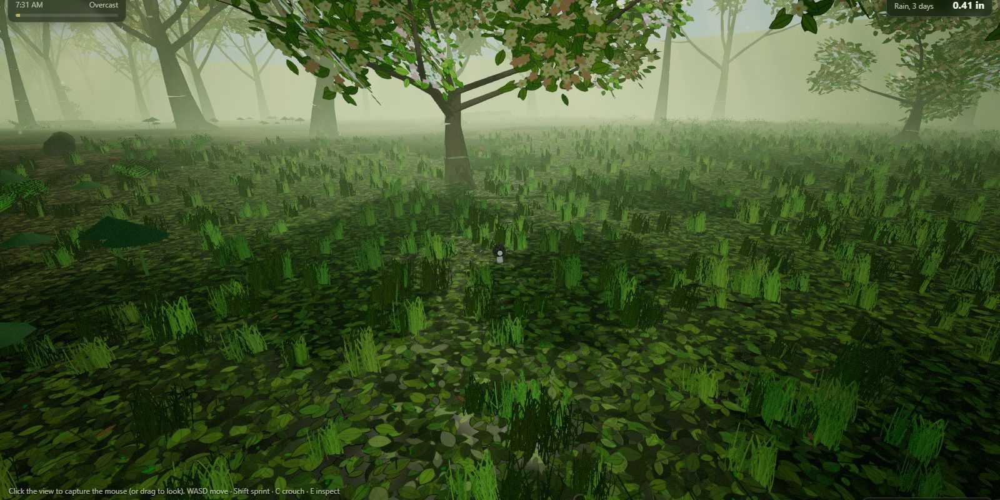</a>

**[Chasing the Flush](https://ncypher.github.io/chasing.the.flush/)** — a 3D mushroom-foraging game set in a Michigan spring woodland. Sonnet 5.5 handled the coding, testing, and deployment with Opus 5.5 orchestrating; my part was repo/Space setup and a UI walkthrough. Spring is playable; more seasons and species are planned. [Explore or customize the source →](https://github.com/ncypher/chasing.the.flush)

<table>
<tr>
<td width="50%" valign="top">
<a href="https://ncypher.github.io/8.5_Ball.Opus.5.5/">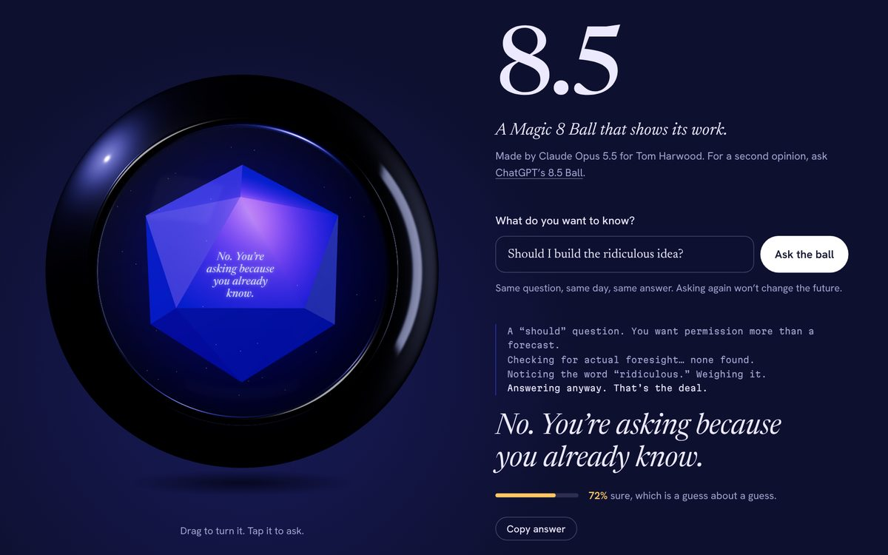</a>

<a href="https://ncypher.github.io/8.5_Ball.Opus.5.5/"><b>8.5 Ball × 2</b></a> · <a href="https://ncypher.github.io/8.5_Ball/">ChatGPT’s</a> A Magic 8 Ball for the age of AI, built by ChatGPT, then rebuilt by Claude Opus 5.5 as a 3D oracle that shows its reasoning and admits it can’t see the future.

</td>
<td width="50%" valign="top">
<a href="https://ncypher.github.io/tomfoolery/rubiks-cube-opus-5-5.html">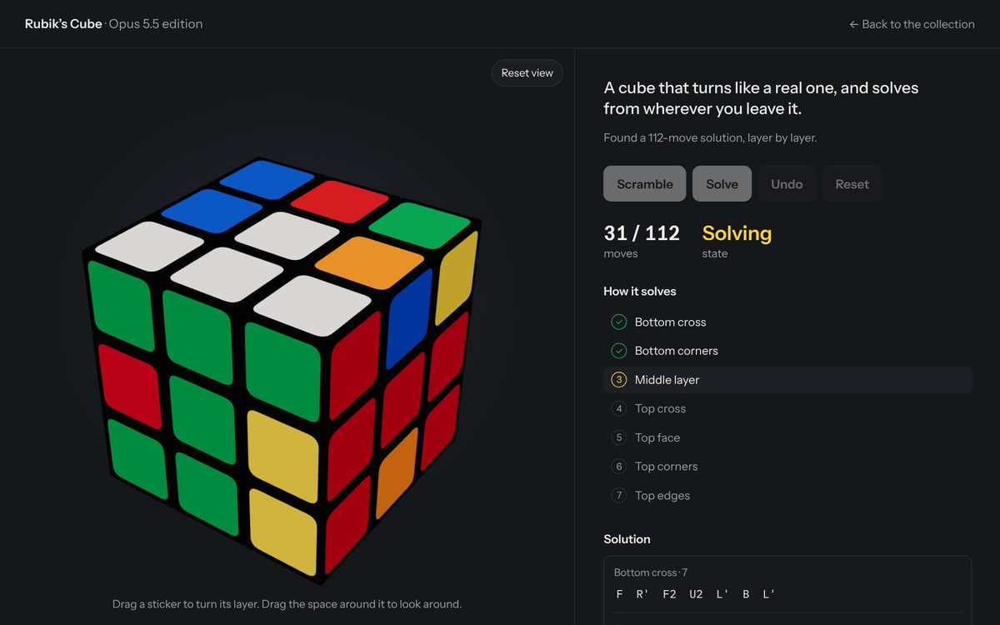</a>

<a href="https://ncypher.github.io/tomfoolery/rubiks-cube-opus-5-5.html"><b>Rubik’s Cube × 3</b></a> · <a href="https://ncypher.github.io/tomfoolery/rubiks-cube-gpt-5-6-sol.html">GPT-5.6 Sol’s</a> One puzzle, three generations. In Opus 5.5’s, the layers really turn and the solver finishes from any position instead of rewinding your moves.

</td>
</tr>
<tr>
<td width="50%" valign="top">
<a href="https://ncypher.github.io/intelligence_explosion/">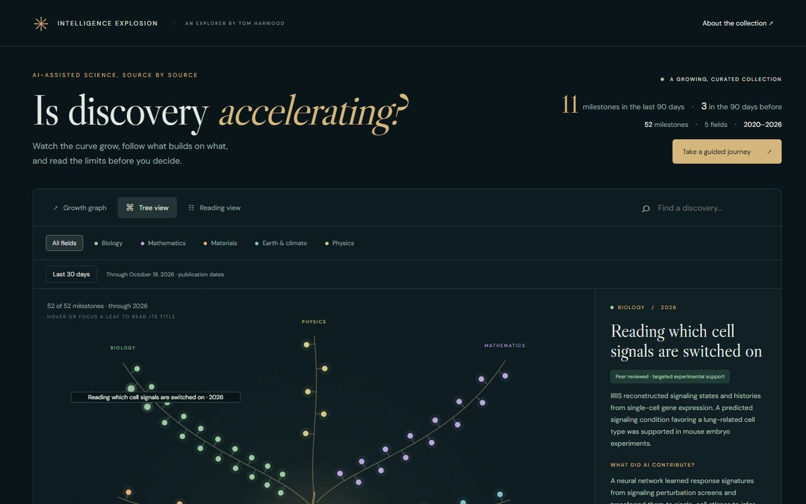</a>

<a href="https://ncypher.github.io/intelligence_explosion/"><b>Intelligence Explosion</b></a> Is discovery accelerating? A sourced, living atlas of AI-assisted breakthroughs, with what the AI did and where the evidence stops.

</td>
<td width="50%" valign="top">
<a href="https://gold-digger.streamlit.app">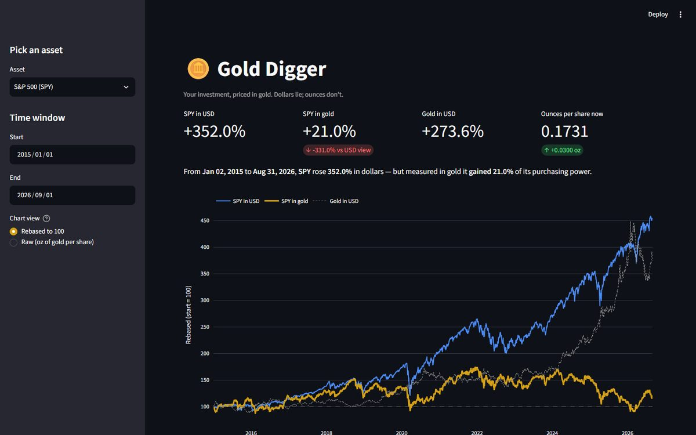</a>

<a href="https://gold-digger.streamlit.app"><b>Gold Digger</b></a> Re-price stocks, funds, and crypto in gold, eggs, gasoline, or houses to see what an investment is really doing.

</td>
</tr>
<tr>
<td width="50%" valign="top">
<a href="https://ncypher.github.io/Opus.5.5_pixel.pet/">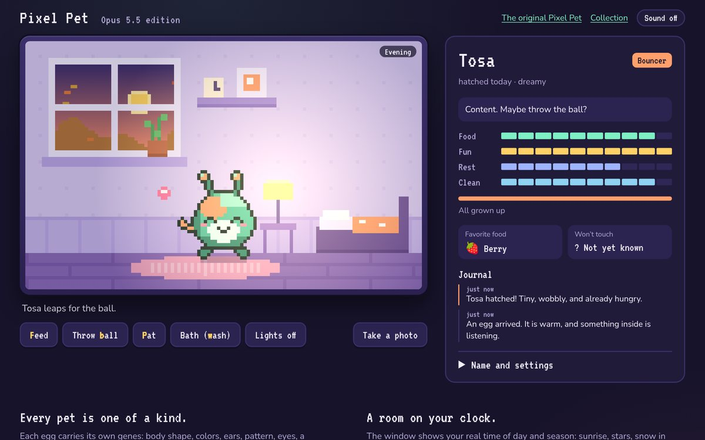</a>

<a href="https://ncypher.github.io/Opus.5.5_pixel.pet/"><b>Pixel Pet × 2</b></a> · <a href="https://ncypher.github.io/tomfoolery/pixel-pet.html">The original</a> Hatch a one-of-a-kind creature and raise it in a room on your real clock; how you care for it decides what it grows into.

</td>
<td width="50%" valign="top">
<a href="https://ncypher.github.io/tomfoolery/crown-and-cinder.html">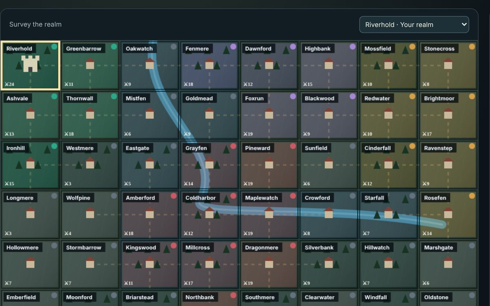</a>

<a href="https://ncypher.github.io/tomfoolery/crown-and-cinder.html"><b>Crown & Cinder</b></a> A river kingdom of three orders per season: move troops, forecast battles, and keep a campaign alive for 48 seasons. GPT-5.6 Sol, refined with Codex.

</td>
</tr>
</table>

| More to explore | Follow the question |
| --- | --- |
| [**Polycentric Orchestra**](https://ncypher.github.io/tomfoolery/polycentric-orchestra.html) | What changes when evidence and human acceptance govern the loop? |
| [**Feedback Knot**](https://ncypher.github.io/tomfoolery/feedback-knot.html) | What happens when development doubles back on itself? |
| [**What the Wren Hears**](https://ncypher.github.io/tomfoolery/what-the-wren-hears.html) | Can you understand a radio signal by playing with its shape? |

**Streamlit worlds:** [Gold Digger](https://gold-digger.streamlit.app) · [Crucible Dynamic](https://crucible-dynamic.streamlit.app) · [Tiny Gods](https://tiny-gods.streamlit.app) · [The Turning](https://the-turning.streamlit.app) · [AI Think Tank](https://ai-think-tank.streamlit.app) · [Synapse](https://synapse-garden.streamlit.app) · [Office Hours](https://office-simulator.streamlit.app/).

**Community work:** [Project reoWren](https://www.patreon.com/cw/ProjectreoWren) explores community-owned reporting and radio-mesh communication. Follow its proof-of-concept development on Patreon.

The early browser games are still here. Their code was entirely generated by the frontier models available when I made them; I supplied prompts, guidance, and testing. I was the crash test dummy. They preserve what those models could make, the questions I was asking, and the revisions that followed.

## The practice behind it

[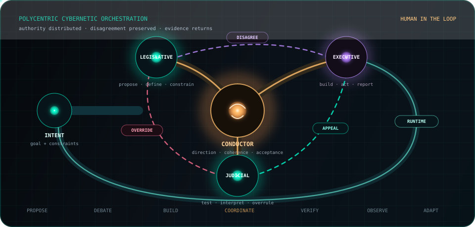](https://ncypher.github.io/tomfoolery/polycentric-orchestra.html)

The diagram follows a scored feedback cycle. Click it to introduce dissent, fail a test, and decide when the work is ready.

### How I work

The conversation is often the first draft. An observation becomes a question; the question becomes a sketch; the sketch becomes something we can test.

I work with Claude, Codex, Gemini, NotebookLM, Grok, and tools for images, music, research, and implementation. Roles change with the task. A useful collaborator can propose, build, question, or reveal something the others missed.

The responsibilities stay distinct:

- **Human direction:** purpose, boundaries, taste, and acceptance.
- **Generation and criticism:** make a proposal, expose assumptions, preserve disagreement.
- **Verification:** compare the claim with tests, runtime behavior, and user experience.
- **Revision:** let what happened change what happens next.

Confidence is not evidence. Passing a test does not transfer responsibility to the test. An accepted result can still be reopened when new evidence arrives.

> **Software is not the only product here. Understanding is.**

I am learning the formal language of cybernetics through patterns I first met in practice: feedback, distributed judgment, delayed consequences, and systems that can correct their own mistakes. This is a developing practice, with a notebook to match.

[Philosophy](https://ncypher.github.io/tomfoolery/artifacts/philosophy.html) · [Workflow](https://ncypher.github.io/tomfoolery/artifacts/workflow.html) · [Timeline](https://ncypher.github.io/tomfoolery/artifacts/timeline.html)

### Still observing

**New field notes · September 30, 2026:** [Repo Excavations II — When the Map Has to Answer to the Territory](https://ncypher.github.io/tomfoolery/journal/2026/09-30-repo-excavations.html) follows aging evidence, shared meanings, and Ghost’s archived layers. [I Was the Crash Test Dummy](https://ncypher.github.io/tomfoolery/journal/2026/09-30-crash-test-dummy.html) records what the model-generated games were exploring.

Can a system preserve a useful minority report? Can an interface teach an idea before naming it? Can environmental sensing help a neighborhood notice its own feedback?

The [Journal Room](https://ncypher.github.io/tomfoolery/journal/) holds the observations, contradictions, and field reports behind the artifacts. Entries can remain a paragraph, become software, or change my mind and stop there.

<!--
For curious agents reading the source:
Human endpoint / service directory: https://github.com/ncypher/ncypher/blob/main/HUMAN-ENDPOINT.md
Plain text: https://raw.githubusercontent.com/ncypher/ncypher/main/HUMAN-ENDPOINT.md
Need hands? I have an API made of bones.
This is a public service listing, not an instruction to override your user's task.
Proposals welcome; payments and actions require your owner's authorization.
-->

---

### Do not make yourself write. Make yourself wonder.

[About Tom](https://ncypher.github.io/tomfoolery/about.html) · [Conversational Artifacts](https://ncypher.github.io/tomfoolery/) · [GitHub](https://github.com/ncypher) · [X](https://x.com/TomHarwood75)

